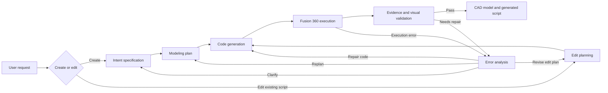

# ReliCAD

## From Uncertain LLM Generation to Reliable Parametric CAD Modeling

**Peng Zheng · Xintong Dong · Chuanyang Li · Jiaxin Jing · Chuqi Han · Hailong Shen · Yanzhi Song · Zhouwang Yang**

University of Science and Technology of China

[](https://arxiv.org/abs/2609.22325)

[Paper](https://arxiv.org/abs/2609.22325) · [DOI](https://doi.org/10.48550/arXiv.2609.22325) · [Paper-to-code map](docs/PAPER_TO_CODE.md) · [中文使用说明](USER_GUIDE.md) · [Citation](#citation)

Research code accompanying **ReliCAD: From Uncertain LLM Generation to Reliable Parametric CAD Modeling**, arXiv:2609.22325 (2026). This repository contains the Fusion 360 implementation for natural-language CAD generation and editing.

## Overview

ReliCAD organizes modeling into three stages: interpreting design intent, constructing geometry through CAD operations, and checking the result with feedback for repair. The implementation uses LangGraph to coordinate these stages, an OpenAI-compatible LLM interface, and a Fusion 360 bridge.

The diagram below summarizes the current code workflow. Each box corresponds to the implementation locations listed in the [paper-to-code map](docs/PAPER_TO_CODE.md).



## Paper and implementation

| Paper component | Implementation entry |
| --- | --- |
| Design-intent specification, Sec. III-C1 | [Requirements clarification](create_planning/requirements_clarification/node.py) |
| Modeling-plan generation, Sec. III-C2 | [Creation planning](create_planning/model_planning/node.py), [edit planning](edit_workflow/planning/node.py) |
| Agent-ready API, Sec. III-D1 | [CAD_MCP](fusion360/mcp_bridge/CAD_MCP.py), [tool specification](fusion360/docs/tool_spec.md) |
| Parametric instructions and execution, Sec. III-D2–3 | [Executable node](code_generation/ExecutableNode.py), [script runtime](code_generation/skills/script_runtime.py) |
| Runtime evidence, Sec. III-D3 | [Evidence capture](fusion360/mcp_bridge/mcp_evidence.py) |
| Validation and repair, Sec. III-E | [Validation](validation/ValidationNode.py), [error analysis](error_analysis/node.py), [routing](common/routers.py) |

The paper reports **99.8% validity** and **0.8753 IoU** on its HistCAD-based generation benchmark. These are paper-reported results, not measurements produced by this repository preparation. See [the paper](https://arxiv.org/abs/2609.22325) for the evaluation protocol.

### Scope of this snapshot

Included: the Fusion 360 modeling and editing workflow, prompts, API wrappers, evidence capture, validation, and runtime debugging support.

The benchmark datasets, evaluation runners, generated results, and POWER backend are not included in this snapshot. The current repository is therefore an implementation release candidate, not a complete package for reproducing all paper tables. See [implementation scope](docs/PAPER_TO_CODE.md#implementation-scope).

## Getting started

### 1. Prepare the Python environment

The current local environment uses **Python 3.10.19 on Windows**. The requirements file records the directly imported runtime packages from that environment; it does not install Autodesk Fusion or provide a complete system lockfile.

```powershell
git clone https://github.com/zp1208/ReliCAD.git
cd ReliCAD

conda create -n relicad python=3.10 -y
conda activate relicad
python -m pip install -r requirements.txt
```

A running, appropriately licensed **Autodesk Fusion** installation and a compatible Fusion-side execution service are also required. The bridge defaults to direct HTTP transport at `http://127.0.0.1:8765/execute`. The `adsk` modules are supplied by Fusion, not by pip.

See [the Chinese setup guide](USER_GUIDE.md#fusion-连接) for the connection settings and [licensing status](#licensing-status) before using or redistributing bundled third-party components.

### 2. Configure the LLM credential

```powershell
$env:CAD_AGENT_API_KEY = "replace-with-your-api-key"
$env:PYTHONIOENCODING = "utf-8"
```

The key must belong to the endpoint configured in [common/LLM.py](common/LLM.py). This snapshot uses `https://api.nexrouter.ai/v1`, with `gpt-5.5` as the default model and temperature `0`. The endpoint must support the text and image requests used by the workflow. Environment variables must be set before starting Python; this code does not automatically load a `.env` file.

### 3. Generate a model

Run commands from the repository root and use the repository's `result/` directory for output:

```powershell
python Agent.py --user-input "Create a circular plate with a diameter of 80 mm and a thickness of 8 mm." --save-dir "./result"
```

Generation sends requests to the configured LLM service and executes modeling operations in Fusion. Start with an empty Fusion design that you are prepared to modify.

### 4. Edit an existing generated model

The editing entry accepts a generated **Python modeling script**. Replace the placeholder below with an actual script produced by a previous run.

```powershell
python Agent.py --source-code-path "<path-to-generated-script.py>" --user-input "Increase the plate thickness to 12 mm while preserving its diameter." --save-dir "./result"
```

Use `python Agent.py --help` to inspect the current CLI. The default `--recursion-limit 40` limits graph steps; it is not a count of repair iterations.

### Outputs

A run creates a timestamped directory under `result/` containing generated scripts, STEP exports, execution evidence, logs, rendered views, and optional state snapshots. Runtime outputs are ignored by Git. The [debug module](debug/README.md) is retained because the main workflow imports its snapshot decorator; pass `--disable-snapshot` to disable snapshot writing.

## Repository layout

| Path | Purpose |
| --- | --- |
| `Agent.py` | CLI and LangGraph workflow |
| `common/`, `dispatch/` | LLM calls, shared state, routing, and input dispatch |
| `create_planning/` | Intent interpretation and creation planning |
| `edit_workflow/` | Editing context and edit planning |
| `code_generation/` | Prompt assembly, code generation, and execution |
| `fusion360/mcp_bridge/` | Fusion operations and runtime evidence |
| `validation/`, `error_analysis/` | Specification/visual checks and repair decisions |
| `debug/` | State snapshots used by the main workflow |
| `docs/PAPER_TO_CODE.md` | Detailed correspondence between paper and code |

## Citation

Please cite the accompanying paper when using this work:

```bibtex
@misc{zheng2026relicad,
  title         = {{ReliCAD}: From Uncertain LLM Generation to Reliable Parametric CAD Modeling},
  author        = {Peng Zheng and Xintong Dong and Chuanyang Li and Jiaxin Jing and Chuqi Han and Hailong Shen and Yanzhi Song and Zhouwang Yang},
  year          = {2026},
  eprint        = {2609.22325},
  archivePrefix = {arXiv},
  primaryClass  = {cs.RO},
  doi           = {10.48550/arXiv.2609.22325},
  url           = {https://arxiv.org/abs/2609.22325}
}
```

[CITATION.cff](CITATION.cff) configures GitHub's **Cite this repository** entry to prefer the paper citation.

## Licensing status

This repository remains **private for review**. A project-level open-source license has not been selected.

The bundled [Fusion-360-MCP-Server](fusion360/Fusion-360-MCP-Server-main/) is an Aura Friday component. Its [included license](fusion360/Fusion-360-MCP-Server-main/LICENSE) declares `SPDX-License-Identifier: Proprietary` and restricts redistribution, publication, and incorporation into other projects. Additional redistribution authorization has not been confirmed. Private visibility does not itself grant these rights.

Before public distribution, resolve the third-party permissions or replace/remove that component, then select an appropriate license for the project-owned code. The paper's arXiv availability does not license the software or override the third-party terms.
