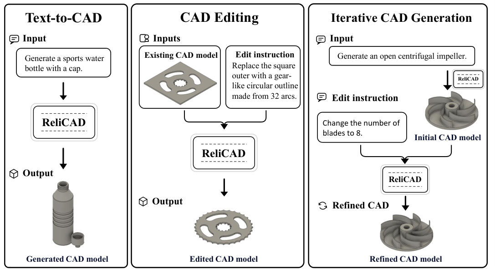

# ReliCAD

Code for [ReliCAD: From Uncertain LLM Generation to Reliable Parametric CAD Modeling](https://arxiv.org/abs/2609.22325).

## Overview



*Figure 1 from the [paper](https://arxiv.org/abs/2609.22325): text-to-CAD generation, CAD editing, and iterative CAD generation.*

## Usage

Requires **Python 3.10**, **Autodesk Fusion**, and a compatible Fusion-side execution service at `http://127.0.0.1:8765/execute`. See the [Chinese setup guide](USER_GUIDE.md) for connection details and third-party licensing.

**1. Install dependencies**

```powershell
git clone https://github.com/zp1208/ReliCAD.git
cd ReliCAD
conda create -n relicad python=3.10 -y
conda activate relicad
python -m pip install -r requirements.txt
```

**2. Configure the API key**

```powershell
$env:CAD_AGENT_API_KEY = "replace-with-your-api-key"
$env:PYTHONIOENCODING = "utf-8"
```

Use a key for the endpoint configured in [common/LLM.py](common/LLM.py), currently `https://api.nexrouter.ai/v1` with `gpt-5.5`.

**3. Generate or edit a model**

Start the Fusion-side service, open an empty Fusion design, and run from the repository root.

Generate a model:

```powershell
python Agent.py --user-input "Create a circular plate with a diameter of 80 mm and a thickness of 8 mm." --save-dir "./result"
```

Edit using a Python modeling script produced by a previous run:

```powershell
python Agent.py --source-code-path "<path-to-generated-script.py>" --user-input "Increase the plate thickness to 12 mm while preserving its diameter." --save-dir "./result"
```

Outputs are saved under `result/`. Use `python Agent.py --help` for all options.

## Citation

If you use this work, please cite:

```bibtex
@misc{zheng2026relicad,
  title         = {{ReliCAD}: From Uncertain LLM Generation to Reliable Parametric CAD Modeling},
  author        = {Peng Zheng and Xintong Dong and Chuanyang Li and Jiaxin Jing and Chuqi Han and Hailong Shen and Yanzhi Song and Zhouwang Yang},
  year          = {2026},
  eprint        = {2609.22325},
  archivePrefix = {arXiv},
  primaryClass  = {cs.RO},
  doi           = {10.48550/arXiv.2609.22325},
  url           = {https://arxiv.org/abs/2609.22325}
}
```
